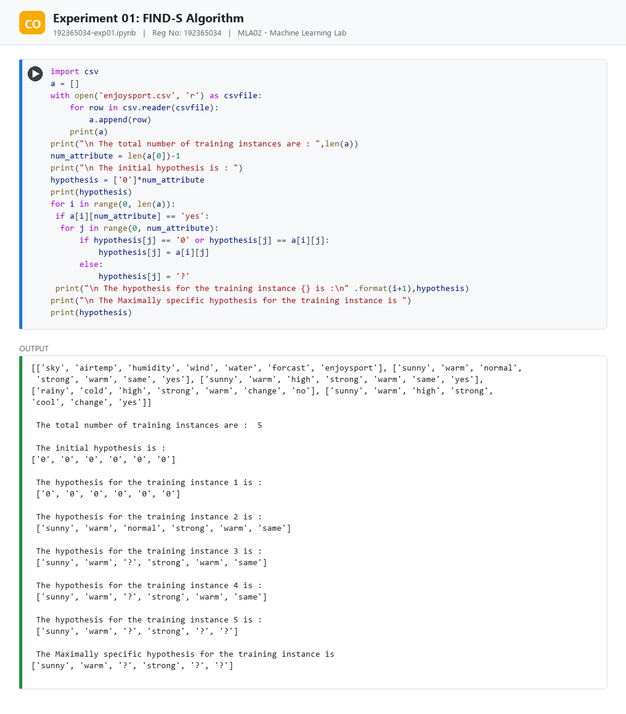

# Experiment 01: FIND-S Algorithm

- **Register Number:** `192365034`
- **Algorithm:** FIND-S (Concept Learning)
- **Dataset:** EnjoySport (`enjoysport.csv`)
- **Google Colab:** [](https://colab.research.google.com/drive/1nMn4cYOa3z20qAi2DI1p1LlpFABIRz7G#scrollTo=qY585LeSe3TC)
- **Direct Colab Link:** https://colab.research.google.com/drive/1nMn4cYOa3z20qAi2DI1p1LlpFABIRz7G#scrollTo=qY585LeSe3TC

## Files

- Python Code: [`192365034-exp01.py`](192365034-exp01.py)
- Jupyter / Colab Notebook: [`192365034-exp01.ipynb`](192365034-exp01.ipynb)
- Google Colab Link: [`colab_link.txt`](colab_link.txt)
- Text Output: [`output.txt`](output.txt)
- Dataset: [`enjoysport.csv`](enjoysport.csv)
- Full Code & Output Screenshot: [`screenshots/code_and_output_screenshot.png`](screenshots/code_and_output_screenshot.png)

## Source Code

```python
import csv
a = []
with open('enjoysport.csv', 'r') as csvfile:
    for row in csv.reader(csvfile):
        a.append(row)
    print(a)
print("\n The total number of training instances are : ",len(a))
num_attribute = len(a[0])-1
print("\n The initial hypothesis is : ")
hypothesis = ['0']*num_attribute
print(hypothesis)
for i in range(0, len(a)):
 if a[i][num_attribute] == 'yes':
  for j in range(0, num_attribute):
      if hypothesis[j] == '0' or hypothesis[j] == a[i][j]:
          hypothesis[j] = a[i][j]
      else:
          hypothesis[j] = '?'
 print("\n The hypothesis for the training instance {} is :\n" .format(i+1),hypothesis)
print("\n The Maximally specific hypothesis for the training instance is ")
print(hypothesis)
```

## Execution Output

```text
[['sky', 'airtemp', 'humidity', 'wind', 'water', 'forcast', 'enjoysport'], ['sunny', 'warm', 'normal', 'strong', 'warm', 'same', 'yes'], ['sunny', 'warm', 'high', 'strong', 'warm', 'same', 'yes'], ['rainy', 'cold', 'high', 'strong', 'warm', 'change', 'no'], ['sunny', 'warm', 'high', 'strong', 'cool', 'change', 'yes']]

 The total number of training instances are :  5

 The initial hypothesis is : 
['0', '0', '0', '0', '0', '0']

 The hypothesis for the training instance 1 is :
 ['0', '0', '0', '0', '0', '0']

 The hypothesis for the training instance 2 is :
 ['sunny', 'warm', 'normal', 'strong', 'warm', 'same']

 The hypothesis for the training instance 3 is :
 ['sunny', 'warm', '?', 'strong', 'warm', 'same']

 The hypothesis for the training instance 4 is :
 ['sunny', 'warm', '?', 'strong', 'warm', 'same']

 The hypothesis for the training instance 5 is :
 ['sunny', 'warm', '?', 'strong', '?', '?']

 The Maximally specific hypothesis for the training instance is 
['sunny', 'warm', '?', 'strong', '?', '?']
```

## Screenshots

### Full Code & Output Screenshot


