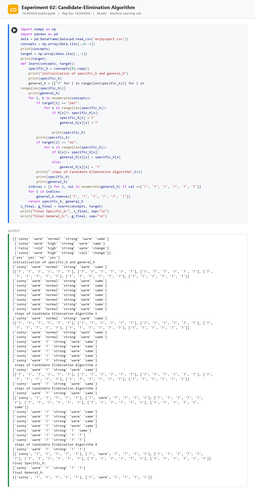

# Experiment 02: Candidate-Elimination Algorithm

- **Register Number:** `192365034`
- **Algorithm:** Candidate-Elimination
- **Dataset:** EnjoySport (`enjoysport.csv`)
- **Google Colab:** [](https://colab.research.google.com/drive/1DhaO6JBqGIhFfzsi2G84sqpv3csj_gEV#scrollTo=v7jFvz4dZA7gEXP)
- **Direct Colab Link:** https://colab.research.google.com/drive/1DhaO6JBqGIhFfzsi2G84sqpv3csj_gEV#scrollTo=v7jFvz4dZA7gEXP

## Files

- Python Code: [`192365034-exp02.py`](192365034-exp02.py)
- Jupyter / Colab Notebook: [`192365034-exp02.ipynb`](192365034-exp02.ipynb)
- Google Colab Link: [`colab_link.txt`](colab_link.txt)
- Text Output: [`output.txt`](output.txt)
- Dataset: [`enjoysport.csv`](enjoysport.csv)
- Full Code & Output Screenshot: [`screenshots/code_and_output_screenshot.png`](screenshots/code_and_output_screenshot.png)

## Source Code

```python
import numpy as np
import pandas as pd
data = pd.DataFrame(data=pd.read_csv('enjoysport.csv'))
concepts = np.array(data.iloc[:,0:-1])
print(concepts)
target = np.array(data.iloc[:,-1])
print(target)
def learn(concepts, target):
    specific_h = concepts[0].copy()
    print("initialization of specific_h and general_h")
    print(specific_h)
    general_h = [["?" for i in range(len(specific_h))] for i in
range(len(specific_h))]
    print(general_h)
    for i, h in enumerate(concepts):
        if target[i] == "yes":
            for x in range(len(specific_h)):
                if h[x]!= specific_h[x]:
                    specific_h[x] ='?'
                    general_h[x][x] ='?'

                print(specific_h)
        print(specific_h)
        if target[i] == "no":
            for x in range(len(specific_h)):
                if h[x]!= specific_h[x]:
                    general_h[x][x] = specific_h[x]
                else:
                    general_h[x][x] = '?'
        print(" steps of Candidate Elimination Algorithm",i+1)
        print(specific_h)
        print(general_h)
    indices = [i for i, val in enumerate(general_h) if val ==['?', '?', '?', '?', '?', '?']]
    for i in indices:
        general_h.remove(['?', '?', '?', '?', '?', '?'])
    return specific_h, general_h
s_final, g_final = learn(concepts, target)
print("Final Specific_h:", s_final, sep="\n")
print("Final General_h:", g_final, sep="\n")
```

## Execution Output

```text
[['sunny' 'warm' 'normal' 'strong' 'warm' 'same']
 ['sunny' 'warm' 'high' 'strong' 'warm' 'same']
 ['rainy' 'cold' 'high' 'strong' 'warm' 'change']
 ['sunny' 'warm' 'high' 'strong' 'cool' 'change']]
['yes' 'yes' 'no' 'yes']
initialization of specific_h and general_h
['sunny' 'warm' 'normal' 'strong' 'warm' 'same']
[['?', '?', '?', '?', '?', '?'], ['?', '?', '?', '?', '?', '?'], ['?', '?', '?', '?', '?', '?'], ['?', '?', '?', '?', '?', '?'], ['?', '?', '?', '?', '?', '?'], ['?', '?', '?', '?', '?', '?']]
['sunny' 'warm' 'normal' 'strong' 'warm' 'same']
['sunny' 'warm' 'normal' 'strong' 'warm' 'same']
['sunny' 'warm' 'normal' 'strong' 'warm' 'same']
['sunny' 'warm' 'normal' 'strong' 'warm' 'same']
['sunny' 'warm' 'normal' 'strong' 'warm' 'same']
['sunny' 'warm' 'normal' 'strong' 'warm' 'same']
['sunny' 'warm' 'normal' 'strong' 'warm' 'same']
 steps of Candidate Elimination Algorithm 1
['sunny' 'warm' 'normal' 'strong' 'warm' 'same']
[['?', '?', '?', '?', '?', '?'], ['?', '?', '?', '?', '?', '?'], ['?', '?', '?', '?', '?', '?'], ['?', '?', '?', '?', '?', '?'], ['?', '?', '?', '?', '?', '?'], ['?', '?', '?', '?', '?', '?']]
['sunny' 'warm' 'normal' 'strong' 'warm' 'same']
['sunny' 'warm' 'normal' 'strong' 'warm' 'same']
['sunny' 'warm' '?' 'strong' 'warm' 'same']
['sunny' 'warm' '?' 'strong' 'warm' 'same']
['sunny' 'warm' '?' 'strong' 'warm' 'same']
['sunny' 'warm' '?' 'strong' 'warm' 'same']
['sunny' 'warm' '?' 'strong' 'warm' 'same']
 steps of Candidate Elimination Algorithm 2
['sunny' 'warm' '?' 'strong' 'warm' 'same']
[['?', '?', '?', '?', '?', '?'], ['?', '?', '?', '?', '?', '?'], ['?', '?', '?', '?', '?', '?'], ['?', '?', '?', '?', '?', '?'], ['?', '?', '?', '?', '?', '?'], ['?', '?', '?', '?', '?', '?']]
['sunny' 'warm' '?' 'strong' 'warm' 'same']
 steps of Candidate Elimination Algorithm 3
['sunny' 'warm' '?' 'strong' 'warm' 'same']
[['sunny', '?', '?', '?', '?', '?'], ['?', 'warm', '?', '?', '?', '?'], ['?', '?', '?', '?', '?', '?'], ['?', '?', '?', '?', '?', '?'], ['?', '?', '?', '?', '?', '?'], ['?', '?', '?', '?', '?', 'same']]
['sunny' 'warm' '?' 'strong' 'warm' 'same']
['sunny' 'warm' '?' 'strong' 'warm' 'same']
['sunny' 'warm' '?' 'strong' 'warm' 'same']
['sunny' 'warm' '?' 'strong' 'warm' 'same']
['sunny' 'warm' '?' 'strong' '?' 'same']
['sunny' 'warm' '?' 'strong' '?' '?']
['sunny' 'warm' '?' 'strong' '?' '?']
 steps of Candidate Elimination Algorithm 4
['sunny' 'warm' '?' 'strong' '?' '?']
[['sunny', '?', '?', '?', '?', '?'], ['?', 'warm', '?', '?', '?', '?'], ['?', '?', '?', '?', '?', '?'], ['?', '?', '?', '?', '?', '?'], ['?', '?', '?', '?', '?', '?'], ['?', '?', '?', '?', '?', '?']]
Final Specific_h:
['sunny' 'warm' '?' 'strong' '?' '?']
Final General_h:
[['sunny', '?', '?', '?', '?', '?'], ['?', 'warm', '?', '?', '?', '?']]
```

## Screenshots

### Full Code & Output Screenshot


