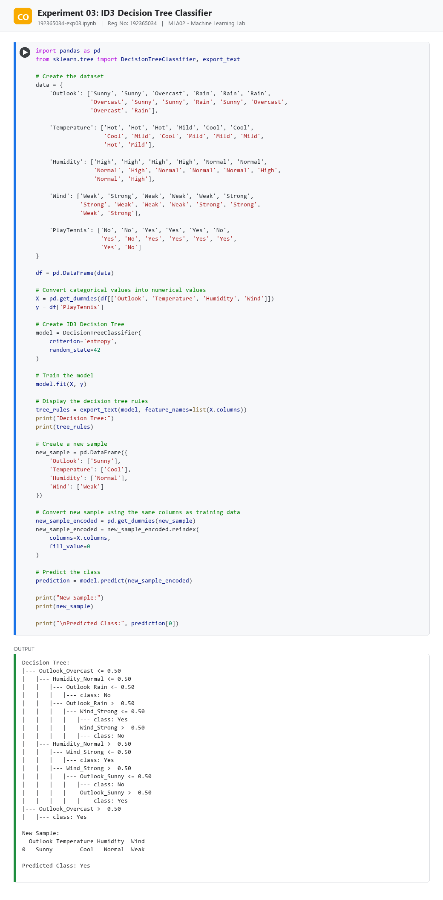

# Experiment 03: ID3 Decision Tree Classifier

- **Register Number:** `192365034`
- **Algorithm:** Decision Tree (Entropy / ID3)
- **Dataset:** PlayTennis Dataset
- **Google Colab:** [](https://colab.research.google.com/drive/1Nhz86fGUmSRKFMHc7fl3-n18UKBfudUo#scrollTo=AgyM4NpUamW1)
- **Direct Colab Link:** https://colab.research.google.com/drive/1Nhz86fGUmSRKFMHc7fl3-n18UKBfudUo#scrollTo=AgyM4NpUamW1

## Files

- Python Code: [`192365034-exp03.py`](192365034-exp03.py)
- Jupyter / Colab Notebook: [`192365034-exp03.ipynb`](192365034-exp03.ipynb)
- Google Colab Link: [`colab_link.txt`](colab_link.txt)
- Text Output: [`output.txt`](output.txt)
- Full Code & Output Screenshot: [`screenshots/code_and_output_screenshot.png`](screenshots/code_and_output_screenshot.png)

## Source Code

```python
import pandas as pd
from sklearn.tree import DecisionTreeClassifier, export_text

# Create the dataset
data = {
    'Outlook': ['Sunny', 'Sunny', 'Overcast', 'Rain', 'Rain', 'Rain',
                'Overcast', 'Sunny', 'Sunny', 'Rain', 'Sunny', 'Overcast',
                'Overcast', 'Rain'],

    'Temperature': ['Hot', 'Hot', 'Hot', 'Mild', 'Cool', 'Cool',
                    'Cool', 'Mild', 'Cool', 'Mild', 'Mild', 'Mild',
                    'Hot', 'Mild'],

    'Humidity': ['High', 'High', 'High', 'High', 'Normal', 'Normal',
                 'Normal', 'High', 'Normal', 'Normal', 'Normal', 'High',
                 'Normal', 'High'],

    'Wind': ['Weak', 'Strong', 'Weak', 'Weak', 'Weak', 'Strong',
             'Strong', 'Weak', 'Weak', 'Weak', 'Strong', 'Strong',
             'Weak', 'Strong'],

    'PlayTennis': ['No', 'No', 'Yes', 'Yes', 'Yes', 'No',
                   'Yes', 'No', 'Yes', 'Yes', 'Yes', 'Yes',
                   'Yes', 'No']
}

df = pd.DataFrame(data)

# Convert categorical values into numerical values
X = pd.get_dummies(df[['Outlook', 'Temperature', 'Humidity', 'Wind']])
y = df['PlayTennis']

# Create ID3 Decision Tree
model = DecisionTreeClassifier(
    criterion='entropy',
    random_state=42
)

# Train the model
model.fit(X, y)

# Display the decision tree rules
tree_rules = export_text(model, feature_names=list(X.columns))
print("Decision Tree:")
print(tree_rules)

# Create a new sample
new_sample = pd.DataFrame({
    'Outlook': ['Sunny'],
    'Temperature': ['Cool'],
    'Humidity': ['Normal'],
    'Wind': ['Weak']
})

# Convert new sample using the same columns as training data
new_sample_encoded = pd.get_dummies(new_sample)
new_sample_encoded = new_sample_encoded.reindex(
    columns=X.columns,
    fill_value=0
)

# Predict the class
prediction = model.predict(new_sample_encoded)

print("New Sample:")
print(new_sample)

print("\nPredicted Class:", prediction[0])
```

## Execution Output

```text
Decision Tree:
|--- Outlook_Overcast <= 0.50
|   |--- Humidity_Normal <= 0.50
|   |   |--- Outlook_Rain <= 0.50
|   |   |   |--- class: No
|   |   |--- Outlook_Rain >  0.50
|   |   |   |--- Wind_Strong <= 0.50
|   |   |   |   |--- class: Yes
|   |   |   |--- Wind_Strong >  0.50
|   |   |   |   |--- class: No
|   |--- Humidity_Normal >  0.50
|   |   |--- Wind_Strong <= 0.50
|   |   |   |--- class: Yes
|   |   |--- Wind_Strong >  0.50
|   |   |   |--- Outlook_Sunny <= 0.50
|   |   |   |   |--- class: No
|   |   |   |--- Outlook_Sunny >  0.50
|   |   |   |   |--- class: Yes
|--- Outlook_Overcast >  0.50
|   |--- class: Yes

New Sample:
  Outlook Temperature Humidity  Wind
0   Sunny        Cool   Normal  Weak

Predicted Class: Yes
```

## Screenshots

### Full Code & Output Screenshot


