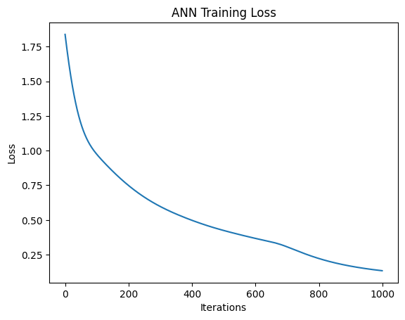
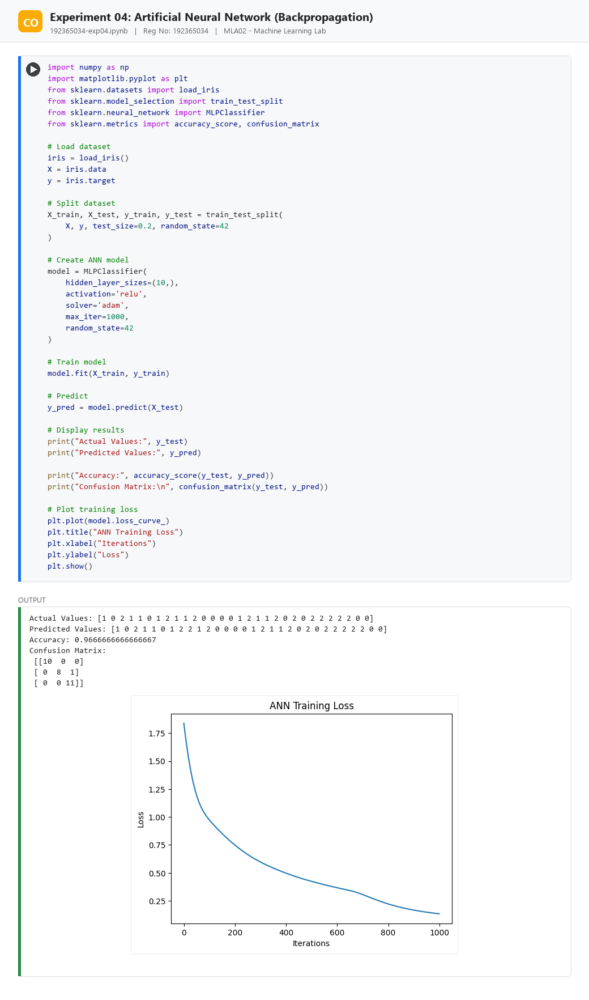

# Experiment 04: Artificial Neural Network (Backpropagation)

- **Register Number:** `192365034`
- **Algorithm:** MLPClassifier (ANN)
- **Dataset:** Iris Dataset
- **Google Colab:** [](https://colab.research.google.com/drive/1PMiixkVXYTQERsEf5f6skPFe03RH_McH#scrollTo=0pa_8ew7PCWx)
- **Direct Colab Link:** https://colab.research.google.com/drive/1PMiixkVXYTQERsEf5f6skPFe03RH_McH#scrollTo=0pa_8ew7PCWx

## Files

- Python Code: [`192365034-exp04.py`](192365034-exp04.py)
- Jupyter / Colab Notebook: [`192365034-exp04.ipynb`](192365034-exp04.ipynb)
- Google Colab Link: [`colab_link.txt`](colab_link.txt)
- Text Output: [`output.txt`](output.txt)
- Full Code & Output Screenshot: [`screenshots/code_and_output_screenshot.png`](screenshots/code_and_output_screenshot.png)
- Output Plot: [`screenshots/plot_ann_training_loss.png`](screenshots/plot_ann_training_loss.png)

## Source Code

```python
import numpy as np
import matplotlib.pyplot as plt
from sklearn.datasets import load_iris
from sklearn.model_selection import train_test_split
from sklearn.neural_network import MLPClassifier
from sklearn.metrics import accuracy_score, confusion_matrix

# Load dataset
iris = load_iris()
X = iris.data
y = iris.target

# Split dataset
X_train, X_test, y_train, y_test = train_test_split(
    X, y, test_size=0.2, random_state=42
)

# Create ANN model
model = MLPClassifier(
    hidden_layer_sizes=(10,),
    activation='relu',
    solver='adam',
    max_iter=1000,
    random_state=42
)

# Train model
model.fit(X_train, y_train)

# Predict
y_pred = model.predict(X_test)

# Display results
print("Actual Values:", y_test)
print("Predicted Values:", y_pred)

print("Accuracy:", accuracy_score(y_test, y_pred))
print("Confusion Matrix:\n", confusion_matrix(y_test, y_pred))

# Plot training loss
plt.plot(model.loss_curve_)
plt.title("ANN Training Loss")
plt.xlabel("Iterations")
plt.ylabel("Loss")
plt.show()
```

## Execution Output

```text
Actual Values: [1 0 2 1 1 0 1 2 1 1 2 0 0 0 0 1 2 1 1 2 0 2 0 2 2 2 2 2 0 0]
Predicted Values: [1 0 2 1 1 0 1 2 2 1 2 0 0 0 0 1 2 1 1 2 0 2 0 2 2 2 2 2 0 0]
Accuracy: 0.9666666666666667
Confusion Matrix:
 [[10  0  0]
 [ 0  8  1]
 [ 0  0 11]]
```

## Screenshots

### Output Graph / Plot



### Full Code & Output Screenshot


