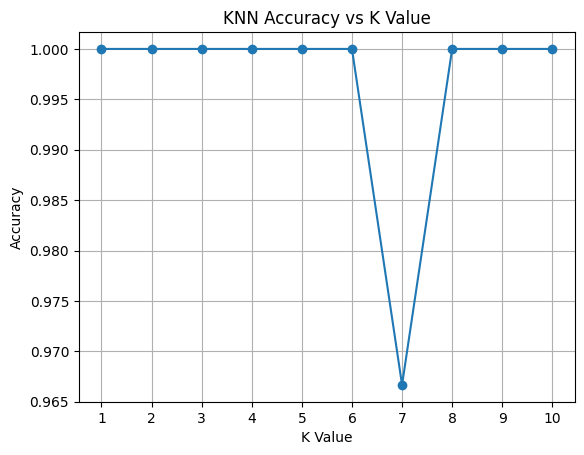
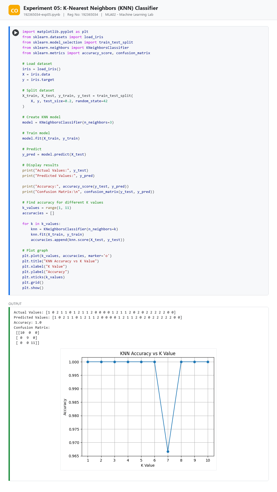

# Experiment 05: K-Nearest Neighbors (KNN) Classifier

- **Register Number:** `192365034`
- **Algorithm:** K-Nearest Neighbors (KNN)
- **Dataset:** Iris Dataset
- **Google Colab:** [](https://colab.research.google.com/drive/14bWTgXhEI-r1vBcCp8vkUVS-cRCLHkBw#scrollTo=OMfYQxj6TiIk)
- **Direct Colab Link:** https://colab.research.google.com/drive/14bWTgXhEI-r1vBcCp8vkUVS-cRCLHkBw#scrollTo=OMfYQxj6TiIk

## Files

- Python Code: [`192365034-exp05.py`](192365034-exp05.py)
- Jupyter / Colab Notebook: [`192365034-exp05.ipynb`](192365034-exp05.ipynb)
- Google Colab Link: [`colab_link.txt`](colab_link.txt)
- Text Output: [`output.txt`](output.txt)
- Full Code & Output Screenshot: [`screenshots/code_and_output_screenshot.png`](screenshots/code_and_output_screenshot.png)
- Output Plot: [`screenshots/plot_knn_accuracy_vs_k.png`](screenshots/plot_knn_accuracy_vs_k.png)

## Source Code

```python
import matplotlib.pyplot as plt
from sklearn.datasets import load_iris
from sklearn.model_selection import train_test_split
from sklearn.neighbors import KNeighborsClassifier
from sklearn.metrics import accuracy_score, confusion_matrix

# Load dataset
iris = load_iris()
X = iris.data
y = iris.target

# Split dataset
X_train, X_test, y_train, y_test = train_test_split(
    X, y, test_size=0.2, random_state=42
)

# Create KNN model
model = KNeighborsClassifier(n_neighbors=3)

# Train model
model.fit(X_train, y_train)

# Predict
y_pred = model.predict(X_test)

# Display results
print("Actual Values:", y_test)
print("Predicted Values:", y_pred)

print("Accuracy:", accuracy_score(y_test, y_pred))
print("Confusion Matrix:\n", confusion_matrix(y_test, y_pred))

# Find accuracy for different K values
k_values = range(1, 11)
accuracies = []

for k in k_values:
    knn = KNeighborsClassifier(n_neighbors=k)
    knn.fit(X_train, y_train)
    accuracies.append(knn.score(X_test, y_test))

# Plot graph
plt.plot(k_values, accuracies, marker='o')
plt.title("KNN Accuracy vs K Value")
plt.xlabel("K Value")
plt.ylabel("Accuracy")
plt.xticks(k_values)
plt.grid()
plt.show()
```

## Execution Output

```text
Actual Values: [1 0 2 1 1 0 1 2 1 1 2 0 0 0 0 1 2 1 1 2 0 2 0 2 2 2 2 2 0 0]
Predicted Values: [1 0 2 1 1 0 1 2 1 1 2 0 0 0 0 1 2 1 1 2 0 2 0 2 2 2 2 2 0 0]
Accuracy: 1.0
Confusion Matrix:
 [[10  0  0]
 [ 0  9  0]
 [ 0  0 11]]
```

## Screenshots

### Output Graph / Plot



### Full Code & Output Screenshot


