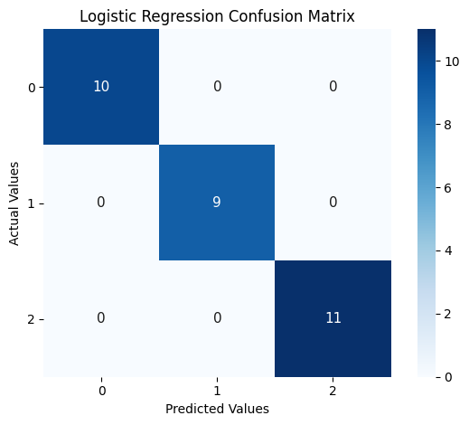
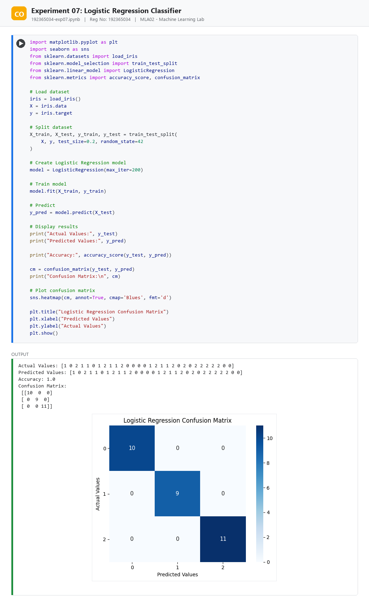

# Experiment 07: Logistic Regression Classifier

- **Register Number:** `192365034`
- **Algorithm:** Logistic Regression
- **Dataset:** Iris Dataset
- **Google Colab:** [](https://colab.research.google.com/drive/1u5-DXUAlndqWDeimnJiV80D4Hh-DR9M3#scrollTo=KzheLVDAUaev)
- **Direct Colab Link:** https://colab.research.google.com/drive/1u5-DXUAlndqWDeimnJiV80D4Hh-DR9M3#scrollTo=KzheLVDAUaev

## Files

- Python Code: [`192365034-exp07.py`](192365034-exp07.py)
- Jupyter / Colab Notebook: [`192365034-exp07.ipynb`](192365034-exp07.ipynb)
- Google Colab Link: [`colab_link.txt`](colab_link.txt)
- Text Output: [`output.txt`](output.txt)
- Full Code & Output Screenshot: [`screenshots/code_and_output_screenshot.png`](screenshots/code_and_output_screenshot.png)
- Output Plot: [`screenshots/plot_logistic_regression_confusion_matrix.png`](screenshots/plot_logistic_regression_confusion_matrix.png)

## Source Code

```python
import matplotlib.pyplot as plt
import seaborn as sns
from sklearn.datasets import load_iris
from sklearn.model_selection import train_test_split
from sklearn.linear_model import LogisticRegression
from sklearn.metrics import accuracy_score, confusion_matrix

# Load dataset
iris = load_iris()
X = iris.data
y = iris.target

# Split dataset
X_train, X_test, y_train, y_test = train_test_split(
    X, y, test_size=0.2, random_state=42
)

# Create Logistic Regression model
model = LogisticRegression(max_iter=200)

# Train model
model.fit(X_train, y_train)

# Predict
y_pred = model.predict(X_test)

# Display results
print("Actual Values:", y_test)
print("Predicted Values:", y_pred)

print("Accuracy:", accuracy_score(y_test, y_pred))

cm = confusion_matrix(y_test, y_pred)
print("Confusion Matrix:\n", cm)

# Plot confusion matrix
sns.heatmap(cm, annot=True, cmap='Blues', fmt='d')

plt.title("Logistic Regression Confusion Matrix")
plt.xlabel("Predicted Values")
plt.ylabel("Actual Values")
plt.show()
```

## Execution Output

```text
Actual Values: [1 0 2 1 1 0 1 2 1 1 2 0 0 0 0 1 2 1 1 2 0 2 0 2 2 2 2 2 0 0]
Predicted Values: [1 0 2 1 1 0 1 2 1 1 2 0 0 0 0 1 2 1 1 2 0 2 0 2 2 2 2 2 0 0]
Accuracy: 1.0
Confusion Matrix:
 [[10  0  0]
 [ 0  9  0]
 [ 0  0 11]]
```

## Screenshots

### Output Graph / Plot



### Full Code & Output Screenshot


