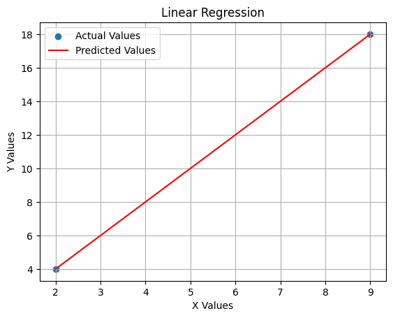
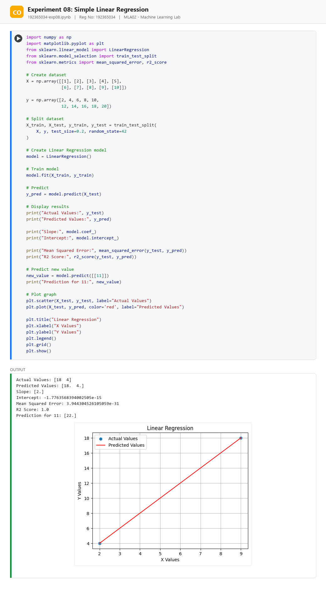

# Experiment 08: Simple Linear Regression

- **Register Number:** `192365034`
- **Algorithm:** Linear Regression
- **Dataset:** Synthetic Linear Dataset
- **Google Colab:** [](https://colab.research.google.com/drive/1x1zn9GsLI7jMsnpV7wCN71ENXi7V10uc)
- **Direct Colab Link:** https://colab.research.google.com/drive/1x1zn9GsLI7jMsnpV7wCN71ENXi7V10uc

## Files

- Python Code: [`192365034-exp08.py`](192365034-exp08.py)
- Jupyter / Colab Notebook: [`192365034-exp08.ipynb`](192365034-exp08.ipynb)
- Google Colab Link: [`colab_link.txt`](colab_link.txt)
- Text Output: [`output.txt`](output.txt)
- Full Code & Output Screenshot: [`screenshots/code_and_output_screenshot.png`](screenshots/code_and_output_screenshot.png)
- Output Plot: [`screenshots/plot_linear_regression.png`](screenshots/plot_linear_regression.png)

## Source Code

```python
import numpy as np
import matplotlib.pyplot as plt
from sklearn.linear_model import LinearRegression
from sklearn.model_selection import train_test_split
from sklearn.metrics import mean_squared_error, r2_score

# Create dataset
X = np.array([[1], [2], [3], [4], [5],
              [6], [7], [8], [9], [10]])

y = np.array([2, 4, 6, 8, 10,
              12, 14, 16, 18, 20])

# Split dataset
X_train, X_test, y_train, y_test = train_test_split(
    X, y, test_size=0.2, random_state=42
)

# Create Linear Regression model
model = LinearRegression()

# Train model
model.fit(X_train, y_train)

# Predict
y_pred = model.predict(X_test)

# Display results
print("Actual Values:", y_test)
print("Predicted Values:", y_pred)

print("Slope:", model.coef_)
print("Intercept:", model.intercept_)

print("Mean Squared Error:", mean_squared_error(y_test, y_pred))
print("R2 Score:", r2_score(y_test, y_pred))

# Predict new value
new_value = model.predict([[11]])
print("Prediction for 11:", new_value)

# Plot graph
plt.scatter(X_test, y_test, label="Actual Values")
plt.plot(X_test, y_pred, color='red', label="Predicted Values")

plt.title("Linear Regression")
plt.xlabel("X Values")
plt.ylabel("Y Values")
plt.legend()
plt.grid()
plt.show()
```

## Execution Output

```text
Actual Values: [18  4]
Predicted Values: [18.  4.]
Slope: [2.]
Intercept: -1.7763568394002505e-15
Mean Squared Error: 3.944304526105059e-31
R2 Score: 1.0
Prediction for 11: [22.]
```

## Screenshots

### Output Graph / Plot



### Full Code & Output Screenshot


