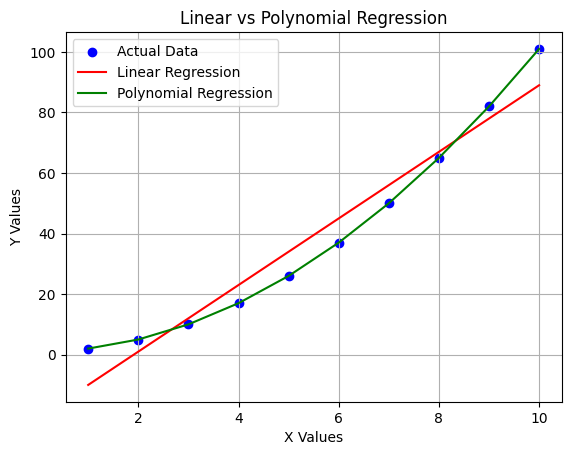
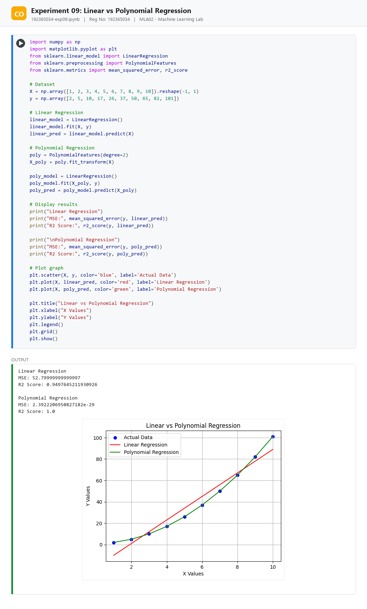

# Experiment 09: Linear vs Polynomial Regression

- **Register Number:** `192365034`
- **Algorithm:** Linear & Polynomial Regression (Degree 2)
- **Dataset:** Synthetic Quadratic Dataset
- **Google Colab:** [](https://colab.research.google.com/drive/10jN03lOyoq3WrMgvC8znXHOe8dt37CWM#scrollTo=N5F8g_O37Fg3)
- **Direct Colab Link:** https://colab.research.google.com/drive/10jN03lOyoq3WrMgvC8znXHOe8dt37CWM#scrollTo=N5F8g_O37Fg3

## Files

- Python Code: [`192365034-exp09.py`](192365034-exp09.py)
- Jupyter / Colab Notebook: [`192365034-exp09.ipynb`](192365034-exp09.ipynb)
- Google Colab Link: [`colab_link.txt`](colab_link.txt)
- Text Output: [`output.txt`](output.txt)
- Full Code & Output Screenshot: [`screenshots/code_and_output_screenshot.png`](screenshots/code_and_output_screenshot.png)
- Output Plot: [`screenshots/plot_linear_vs_polynomial_regression.png`](screenshots/plot_linear_vs_polynomial_regression.png)

## Source Code

```python
import numpy as np
import matplotlib.pyplot as plt
from sklearn.linear_model import LinearRegression
from sklearn.preprocessing import PolynomialFeatures
from sklearn.metrics import mean_squared_error, r2_score

# Dataset
X = np.array([1, 2, 3, 4, 5, 6, 7, 8, 9, 10]).reshape(-1, 1)
y = np.array([2, 5, 10, 17, 26, 37, 50, 65, 82, 101])

# Linear Regression
linear_model = LinearRegression()
linear_model.fit(X, y)
linear_pred = linear_model.predict(X)

# Polynomial Regression
poly = PolynomialFeatures(degree=2)
X_poly = poly.fit_transform(X)

poly_model = LinearRegression()
poly_model.fit(X_poly, y)
poly_pred = poly_model.predict(X_poly)

# Display results
print("Linear Regression")
print("MSE:", mean_squared_error(y, linear_pred))
print("R2 Score:", r2_score(y, linear_pred))

print("\nPolynomial Regression")
print("MSE:", mean_squared_error(y, poly_pred))
print("R2 Score:", r2_score(y, poly_pred))

# Plot graph
plt.scatter(X, y, color='blue', label='Actual Data')
plt.plot(X, linear_pred, color='red', label='Linear Regression')
plt.plot(X, poly_pred, color='green', label='Polynomial Regression')

plt.title("Linear vs Polynomial Regression")
plt.xlabel("X Values")
plt.ylabel("Y Values")
plt.legend()
plt.grid()
plt.show()
```

## Execution Output

```text
Linear Regression
MSE: 52.79999999999997
R2 Score: 0.9497645211930926

Polynomial Regression
MSE: 2.3922206950827182e-29
R2 Score: 1.0
```

## Screenshots

### Output Graph / Plot



### Full Code & Output Screenshot


