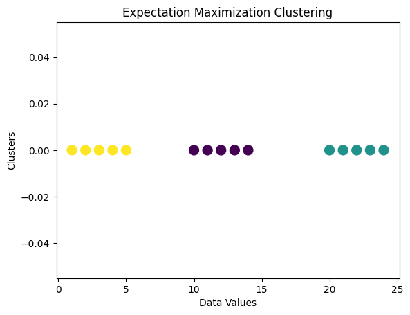
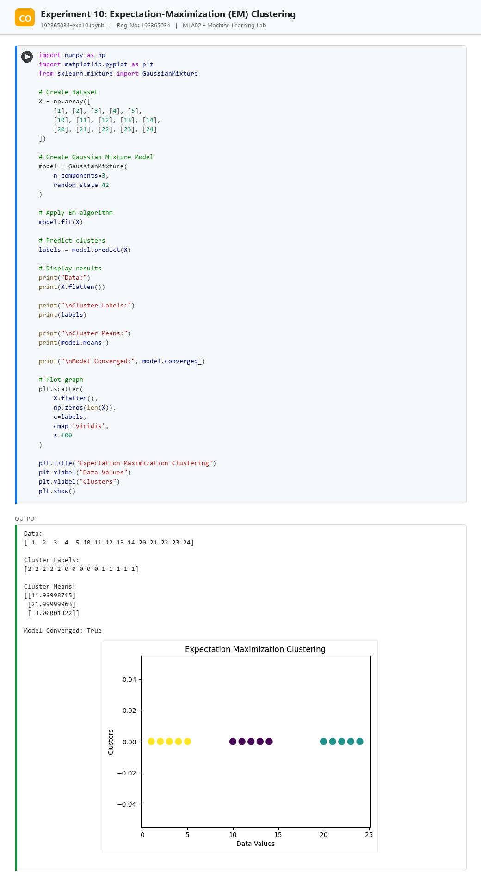

# Experiment 10: Expectation-Maximization (EM) Clustering

- **Register Number:** `192365034`
- **Algorithm:** Gaussian Mixture Model (EM)
- **Dataset:** Synthetic 1D Clusters
- **Google Colab:** [](https://colab.research.google.com/drive/1_gYEGgglvgz5l3qyl9Bulec8pcpcBL3I#scrollTo=fXFIPUsL7gtb)
- **Direct Colab Link:** https://colab.research.google.com/drive/1_gYEGgglvgz5l3qyl9Bulec8pcpcBL3I#scrollTo=fXFIPUsL7gtb

## Files

- Python Code: [`192365034-exp10.py`](192365034-exp10.py)
- Jupyter / Colab Notebook: [`192365034-exp10.ipynb`](192365034-exp10.ipynb)
- Google Colab Link: [`colab_link.txt`](colab_link.txt)
- Text Output: [`output.txt`](output.txt)
- Full Code & Output Screenshot: [`screenshots/code_and_output_screenshot.png`](screenshots/code_and_output_screenshot.png)
- Output Plot: [`screenshots/plot_em_clustering.png`](screenshots/plot_em_clustering.png)

## Source Code

```python
import numpy as np
import matplotlib.pyplot as plt
from sklearn.mixture import GaussianMixture

# Create dataset
X = np.array([
    [1], [2], [3], [4], [5],
    [10], [11], [12], [13], [14],
    [20], [21], [22], [23], [24]
])

# Create Gaussian Mixture Model
model = GaussianMixture(
    n_components=3,
    random_state=42
)

# Apply EM algorithm
model.fit(X)

# Predict clusters
labels = model.predict(X)

# Display results
print("Data:")
print(X.flatten())

print("\nCluster Labels:")
print(labels)

print("\nCluster Means:")
print(model.means_)

print("\nModel Converged:", model.converged_)

# Plot graph
plt.scatter(
    X.flatten(),
    np.zeros(len(X)),
    c=labels,
    cmap='viridis',
    s=100
)

plt.title("Expectation Maximization Clustering")
plt.xlabel("Data Values")
plt.ylabel("Clusters")
plt.show()
```

## Execution Output

```text
Data:
[ 1  2  3  4  5 10 11 12 13 14 20 21 22 23 24]

Cluster Labels:
[2 2 2 2 2 0 0 0 0 0 1 1 1 1 1]

Cluster Means:
[[11.99998715]
 [21.99999963]
 [ 3.00001322]]

Model Converged: True
```

## Screenshots

### Output Graph / Plot



### Full Code & Output Screenshot


