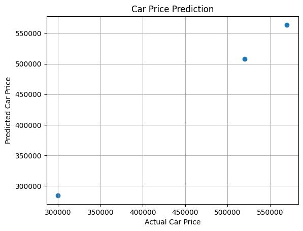
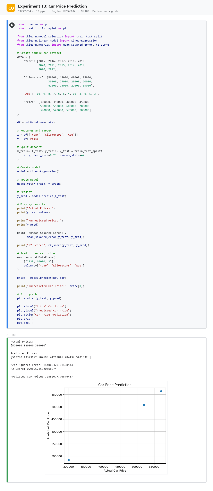

# Experiment 13: Car Price Prediction

- **Register Number:** `192365034`
- **Algorithm:** Multiple Linear Regression
- **Dataset:** Sample Car Dataset
- **Google Colab:** [](https://colab.research.google.com/drive/1VcRXh4E8m6sgWpU55q6INcaY6CBY663o)
- **Direct Colab Link:** https://colab.research.google.com/drive/1VcRXh4E8m6sgWpU55q6INcaY6CBY663o

## Files

- Python Code: [`192365034-exp13.py`](192365034-exp13.py)
- Jupyter / Colab Notebook: [`192365034-exp13.ipynb`](192365034-exp13.ipynb)
- Google Colab Link: [`colab_link.txt`](colab_link.txt)
- Text Output: [`output.txt`](output.txt)
- Full Code & Output Screenshot: [`screenshots/code_and_output_screenshot.png`](screenshots/code_and_output_screenshot.png)
- Output Plot: [`screenshots/plot_car_price_prediction.png`](screenshots/plot_car_price_prediction.png)

## Source Code

```python
import pandas as pd
import matplotlib.pyplot as plt

from sklearn.model_selection import train_test_split
from sklearn.linear_model import LinearRegression
from sklearn.metrics import mean_squared_error, r2_score

# Create sample car dataset
data = {
    'Year': [2015, 2016, 2017, 2018, 2019,
             2020, 2021, 2015, 2017, 2019,
             2020, 2022],

    'Kilometers': [50000, 45000, 40000, 35000,
                   30000, 25000, 20000, 60000,
                   42000, 28000, 22000, 15000],

    'Age': [10, 9, 8, 7, 6, 5, 4, 10, 8, 6, 5, 3],

    'Price': [300000, 350000, 400000, 450000,
              500000, 550000, 600000, 280000,
              390000, 520000, 570000, 700000]
}

df = pd.DataFrame(data)

# Features and target
X = df[['Year', 'Kilometers', 'Age']]
y = df['Price']

# Split dataset
X_train, X_test, y_train, y_test = train_test_split(
    X, y, test_size=0.25, random_state=42
)

# Create model
model = LinearRegression()

# Train model
model.fit(X_train, y_train)

# Predict
y_pred = model.predict(X_test)

# Display results
print("Actual Prices:")
print(y_test.values)

print("\nPredicted Prices:")
print(y_pred)

print("\nMean Squared Error:",
      mean_squared_error(y_test, y_pred))

print("R2 Score:", r2_score(y_test, y_pred))

# Predict new car price
new_car = pd.DataFrame(
    [[2023, 10000, 2]],
    columns=['Year', 'Kilometers', 'Age']
)

price = model.predict(new_car)

print("\nPredicted Car Price:", price[0])

# Plot graph
plt.scatter(y_test, y_pred)

plt.xlabel("Actual Car Price")
plt.ylabel("Predicted Car Price")
plt.title("Car Price Prediction")
plt.grid()
plt.show()
```

## Execution Output

```text
Actual Prices:
[570000 520000 300000]

Predicted Prices:
[563780.19323672 507698.41269841 284437.5431332 ]

Mean Squared Error: 144068370.01408544
R2 Score: 0.9895265320668274

Predicted Car Price: 728826.7770876437
```

## Screenshots

### Output Graph / Plot



### Full Code & Output Screenshot


