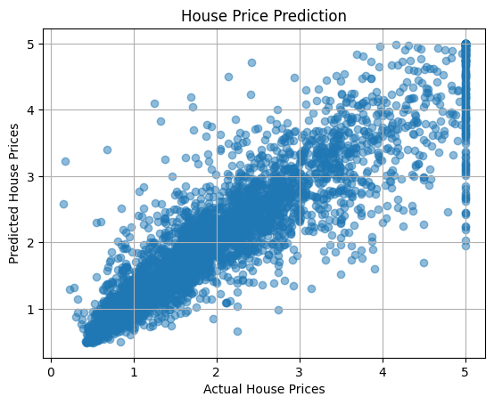
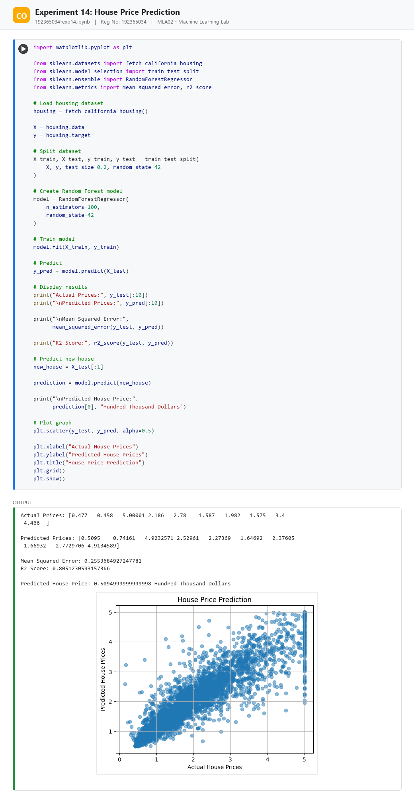

# Experiment 14: House Price Prediction

- **Register Number:** `192365034`
- **Algorithm:** Random Forest Regressor
- **Dataset:** California Housing Dataset
- **Google Colab:** [](https://colab.research.google.com/drive/1LQiGbDceGo79NIsOyKmLbRBmprVNU2rz)
- **Direct Colab Link:** https://colab.research.google.com/drive/1LQiGbDceGo79NIsOyKmLbRBmprVNU2rz

## Files

- Python Code: [`192365034-exp14.py`](192365034-exp14.py)
- Jupyter / Colab Notebook: [`192365034-exp14.ipynb`](192365034-exp14.ipynb)
- Google Colab Link: [`colab_link.txt`](colab_link.txt)
- Text Output: [`output.txt`](output.txt)
- Full Code & Output Screenshot: [`screenshots/code_and_output_screenshot.png`](screenshots/code_and_output_screenshot.png)
- Output Plot: [`screenshots/plot_house_price_prediction.png`](screenshots/plot_house_price_prediction.png)

## Source Code

```python
import matplotlib.pyplot as plt

from sklearn.datasets import fetch_california_housing
from sklearn.model_selection import train_test_split
from sklearn.ensemble import RandomForestRegressor
from sklearn.metrics import mean_squared_error, r2_score

# Load housing dataset
housing = fetch_california_housing()

X = housing.data
y = housing.target

# Split dataset
X_train, X_test, y_train, y_test = train_test_split(
    X, y, test_size=0.2, random_state=42
)

# Create Random Forest model
model = RandomForestRegressor(
    n_estimators=100,
    random_state=42
)

# Train model
model.fit(X_train, y_train)

# Predict
y_pred = model.predict(X_test)

# Display results
print("Actual Prices:", y_test[:10])
print("\nPredicted Prices:", y_pred[:10])

print("\nMean Squared Error:",
      mean_squared_error(y_test, y_pred))

print("R2 Score:", r2_score(y_test, y_pred))

# Predict new house
new_house = X_test[:1]

prediction = model.predict(new_house)

print("\nPredicted House Price:",
      prediction[0], "Hundred Thousand Dollars")

# Plot graph
plt.scatter(y_test, y_pred, alpha=0.5)

plt.xlabel("Actual House Prices")
plt.ylabel("Predicted House Prices")
plt.title("House Price Prediction")
plt.grid()
plt.show()
```

## Execution Output

```text
Actual Prices: [0.477   0.458   5.00001 2.186   2.78    1.587   1.982   1.575   3.4
 4.466  ]

Predicted Prices: [0.5095    0.74161   4.9232571 2.52961   2.27369   1.64692   2.37605
 1.66932   2.7729706 4.9134589]

Mean Squared Error: 0.2553684927247781
R2 Score: 0.8051230593157366

Predicted House Price: 0.5094999999999998 Hundred Thousand Dollars
```

## Screenshots

### Output Graph / Plot



### Full Code & Output Screenshot


