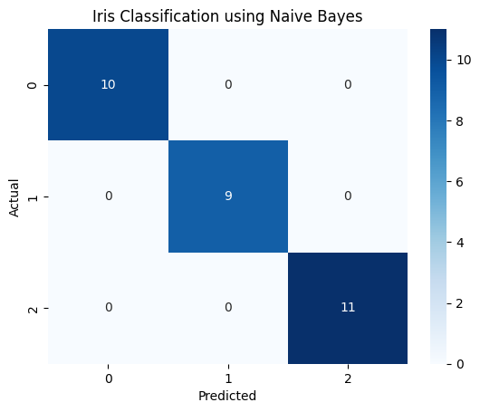
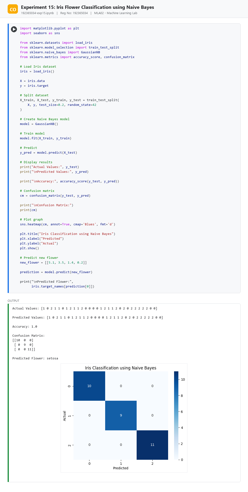

# Experiment 15: Iris Flower Classification using Naive Bayes

- **Register Number:** `192365034`
- **Algorithm:** Gaussian Naive Bayes
- **Dataset:** Iris Dataset
- **Google Colab:** [](https://colab.research.google.com/drive/1dQVRh6gs64Rxz00yEl3fqMQXbPDhOcBS#scrollTo=J9TIuOG-OIdQ)
- **Direct Colab Link:** https://colab.research.google.com/drive/1dQVRh6gs64Rxz00yEl3fqMQXbPDhOcBS#scrollTo=J9TIuOG-OIdQ

## Files

- Python Code: [`192365034-exp15.py`](192365034-exp15.py)
- Jupyter / Colab Notebook: [`192365034-exp15.ipynb`](192365034-exp15.ipynb)
- Google Colab Link: [`colab_link.txt`](colab_link.txt)
- Text Output: [`output.txt`](output.txt)
- Full Code & Output Screenshot: [`screenshots/code_and_output_screenshot.png`](screenshots/code_and_output_screenshot.png)
- Output Plot: [`screenshots/plot_iris_naive_bayes_confusion_matrix.png`](screenshots/plot_iris_naive_bayes_confusion_matrix.png)

## Source Code

```python
import matplotlib.pyplot as plt
import seaborn as sns

from sklearn.datasets import load_iris
from sklearn.model_selection import train_test_split
from sklearn.naive_bayes import GaussianNB
from sklearn.metrics import accuracy_score, confusion_matrix

# Load Iris dataset
iris = load_iris()

X = iris.data
y = iris.target

# Split dataset
X_train, X_test, y_train, y_test = train_test_split(
    X, y, test_size=0.2, random_state=42
)

# Create Naive Bayes model
model = GaussianNB()

# Train model
model.fit(X_train, y_train)

# Predict
y_pred = model.predict(X_test)

# Display results
print("Actual Values:", y_test)
print("\nPredicted Values:", y_pred)

print("\nAccuracy:", accuracy_score(y_test, y_pred))

# Confusion matrix
cm = confusion_matrix(y_test, y_pred)

print("\nConfusion Matrix:")
print(cm)

# Plot graph
sns.heatmap(cm, annot=True, cmap='Blues', fmt='d')

plt.title("Iris Classification using Naive Bayes")
plt.xlabel("Predicted")
plt.ylabel("Actual")
plt.show()

# Predict new flower
new_flower = [[5.1, 3.5, 1.4, 0.2]]

prediction = model.predict(new_flower)

print("\nPredicted Flower:",
      iris.target_names[prediction[0]])
```

## Execution Output

```text
Actual Values: [1 0 2 1 1 0 1 2 1 1 2 0 0 0 0 1 2 1 1 2 0 2 0 2 2 2 2 2 0 0]

Predicted Values: [1 0 2 1 1 0 1 2 1 1 2 0 0 0 0 1 2 1 1 2 0 2 0 2 2 2 2 2 0 0]

Accuracy: 1.0

Confusion Matrix:
[[10  0  0]
 [ 0  9  0]
 [ 0  0 11]]

Predicted Flower: setosa
```

## Screenshots

### Output Graph / Plot



### Full Code & Output Screenshot


