# MLA02 — Machine Learning Lab Programs (`192365034`)

Complete collection of all **16 Machine Learning Laboratory Experiments**, clearly organized with:
- Standalone Python code (`.py`)
- Executable Jupyter / Google Colab notebooks (`.ipynb` with saved outputs)
- Direct **Google Colab links** (`colab_link.txt` & one-click badges)
- Captured text outputs (`output.txt`) & datasets (`enjoysport.csv`)
- High-resolution **output plots and code+output screenshots** (`screenshots/`)

## Lab Programs Index

| Exp | Experiment Title | Algorithm | Code | Google Colab | Screenshots |
|:---:|---|---|---|---:|---|
| **01** | [FIND-S Algorithm](Exp01_Find_S_Algorithm/README.md) | FIND-S (Concept Learning) | [`.py`](Exp01_Find_S_Algorithm/192365034-exp01.py) · [`.ipynb`](Exp01_Find_S_Algorithm/192365034-exp01.ipynb) |  | [Screenshot](Exp01_Find_S_Algorithm/screenshots/code_and_output_screenshot.png) |
| **02** | [Candidate-Elimination Algorithm](Exp02_Candidate_Elimination/README.md) | Candidate-Elimination | [`.py`](Exp02_Candidate_Elimination/192365034-exp02.py) · [`.ipynb`](Exp02_Candidate_Elimination/192365034-exp02.ipynb) |  | [Screenshot](Exp02_Candidate_Elimination/screenshots/code_and_output_screenshot.png) |
| **03** | [ID3 Decision Tree Classifier](Exp03_ID3_Decision_Tree/README.md) | Decision Tree (Entropy / ID3) | [`.py`](Exp03_ID3_Decision_Tree/192365034-exp03.py) · [`.ipynb`](Exp03_ID3_Decision_Tree/192365034-exp03.ipynb) |  | [Screenshot](Exp03_ID3_Decision_Tree/screenshots/code_and_output_screenshot.png) |
| **04** | [Artificial Neural Network (Backpropagation)](Exp04_ANN_Backpropagation/README.md) | MLPClassifier (ANN) | [`.py`](Exp04_ANN_Backpropagation/192365034-exp04.py) · [`.ipynb`](Exp04_ANN_Backpropagation/192365034-exp04.ipynb) |  | [Screenshot](Exp04_ANN_Backpropagation/screenshots/code_and_output_screenshot.png) · [Plot](Exp04_ANN_Backpropagation/screenshots/plot_ann_training_loss.png) |
| **05** | [K-Nearest Neighbors (KNN) Classifier](Exp05_KNN_Classifier/README.md) | K-Nearest Neighbors (KNN) | [`.py`](Exp05_KNN_Classifier/192365034-exp05.py) · [`.ipynb`](Exp05_KNN_Classifier/192365034-exp05.ipynb) |  | [Screenshot](Exp05_KNN_Classifier/screenshots/code_and_output_screenshot.png) · [Plot](Exp05_KNN_Classifier/screenshots/plot_knn_accuracy_vs_k.png) |
| **06** | [Naive Bayes Classifier](Exp06_Naive_Bayes_Classifier/README.md) | Gaussian Naive Bayes | [`.py`](Exp06_Naive_Bayes_Classifier/192365034-exp06.py) · [`.ipynb`](Exp06_Naive_Bayes_Classifier/192365034-exp06.ipynb) |  | [Screenshot](Exp06_Naive_Bayes_Classifier/screenshots/code_and_output_screenshot.png) · [Plot](Exp06_Naive_Bayes_Classifier/screenshots/plot_naive_bayes_confusion_matrix.png) |
| **07** | [Logistic Regression Classifier](Exp07_Logistic_Regression/README.md) | Logistic Regression | [`.py`](Exp07_Logistic_Regression/192365034-exp07.py) · [`.ipynb`](Exp07_Logistic_Regression/192365034-exp07.ipynb) |  | [Screenshot](Exp07_Logistic_Regression/screenshots/code_and_output_screenshot.png) · [Plot](Exp07_Logistic_Regression/screenshots/plot_logistic_regression_confusion_matrix.png) |
| **08** | [Simple Linear Regression](Exp08_Linear_Regression/README.md) | Linear Regression | [`.py`](Exp08_Linear_Regression/192365034-exp08.py) · [`.ipynb`](Exp08_Linear_Regression/192365034-exp08.ipynb) |  | [Screenshot](Exp08_Linear_Regression/screenshots/code_and_output_screenshot.png) · [Plot](Exp08_Linear_Regression/screenshots/plot_linear_regression.png) |
| **09** | [Linear vs Polynomial Regression](Exp09_Linear_vs_Polynomial_Regression/README.md) | Linear & Polynomial Regression (Degree 2) | [`.py`](Exp09_Linear_vs_Polynomial_Regression/192365034-exp09.py) · [`.ipynb`](Exp09_Linear_vs_Polynomial_Regression/192365034-exp09.ipynb) |  | [Screenshot](Exp09_Linear_vs_Polynomial_Regression/screenshots/code_and_output_screenshot.png) · [Plot](Exp09_Linear_vs_Polynomial_Regression/screenshots/plot_linear_vs_polynomial_regression.png) |
| **10** | [Expectation-Maximization (EM) Clustering](Exp10_EM_Clustering_GMM/README.md) | Gaussian Mixture Model (EM) | [`.py`](Exp10_EM_Clustering_GMM/192365034-exp10.py) · [`.ipynb`](Exp10_EM_Clustering_GMM/192365034-exp10.ipynb) |  | [Screenshot](Exp10_EM_Clustering_GMM/screenshots/code_and_output_screenshot.png) · [Plot](Exp10_EM_Clustering_GMM/screenshots/plot_em_clustering.png) |
| **11** | [Credit Score Classification](Exp11_Credit_Score_Classification/README.md) | Random Forest Classifier | [`.py`](Exp11_Credit_Score_Classification/192365034-exp11.py) · [`.ipynb`](Exp11_Credit_Score_Classification/192365034-exp11.ipynb) |  | [Screenshot](Exp11_Credit_Score_Classification/screenshots/code_and_output_screenshot.png) · [Plot](Exp11_Credit_Score_Classification/screenshots/plot_credit_score_confusion_matrix.png) |
| **12** | [Iris Flower Classification using KNN](Exp12_Iris_Classification_KNN/README.md) | K-Nearest Neighbors (KNN) | [`.py`](Exp12_Iris_Classification_KNN/192365034-exp12.py) · [`.ipynb`](Exp12_Iris_Classification_KNN/192365034-exp12.ipynb) |  | [Screenshot](Exp12_Iris_Classification_KNN/screenshots/code_and_output_screenshot.png) · [Plot](Exp12_Iris_Classification_KNN/screenshots/plot_iris_knn_confusion_matrix.png) |
| **13** | [Car Price Prediction](Exp13_Car_Price_Prediction/README.md) | Multiple Linear Regression | [`.py`](Exp13_Car_Price_Prediction/192365034-exp13.py) · [`.ipynb`](Exp13_Car_Price_Prediction/192365034-exp13.ipynb) |  | [Screenshot](Exp13_Car_Price_Prediction/screenshots/code_and_output_screenshot.png) · [Plot](Exp13_Car_Price_Prediction/screenshots/plot_car_price_prediction.png) |
| **14** | [House Price Prediction](Exp14_House_Price_Prediction/README.md) | Random Forest Regressor | [`.py`](Exp14_House_Price_Prediction/192365034-exp14.py) · [`.ipynb`](Exp14_House_Price_Prediction/192365034-exp14.ipynb) |  | [Screenshot](Exp14_House_Price_Prediction/screenshots/code_and_output_screenshot.png) · [Plot](Exp14_House_Price_Prediction/screenshots/plot_house_price_prediction.png) |
| **15** | [Iris Flower Classification using Naive Bayes](Exp15_Iris_Classification_Naive_Bayes/README.md) | Gaussian Naive Bayes | [`.py`](Exp15_Iris_Classification_Naive_Bayes/192365034-exp15.py) · [`.ipynb`](Exp15_Iris_Classification_Naive_Bayes/192365034-exp15.ipynb) |  | [Screenshot](Exp15_Iris_Classification_Naive_Bayes/screenshots/code_and_output_screenshot.png) · [Plot](Exp15_Iris_Classification_Naive_Bayes/screenshots/plot_iris_naive_bayes_confusion_matrix.png) |
| **16** | [Comparison of Classification Algorithms](Exp16_Classification_Algorithm_Comparison/README.md) | LR, KNN, DT, RF, NB, SVM | [`.py`](Exp16_Classification_Algorithm_Comparison/192365034-exp16.py) · [`.ipynb`](Exp16_Classification_Algorithm_Comparison/192365034-exp16.ipynb) |  | [Screenshot](Exp16_Classification_Algorithm_Comparison/screenshots/code_and_output_screenshot.png) · [Plot 1](Exp16_Classification_Algorithm_Comparison/screenshots/plot_1_algorithm_comparison.png) · [Plot 2](Exp16_Classification_Algorithm_Comparison/screenshots/plot_2_best_model_confusion_matrix.png) |

---

## All Google Colab Links

See [`colab_links.md`](colab_links.md) for the complete list of all 16 direct Colab URLs.

## Output Plots Preview

### Experiment 01: FIND-S Algorithm
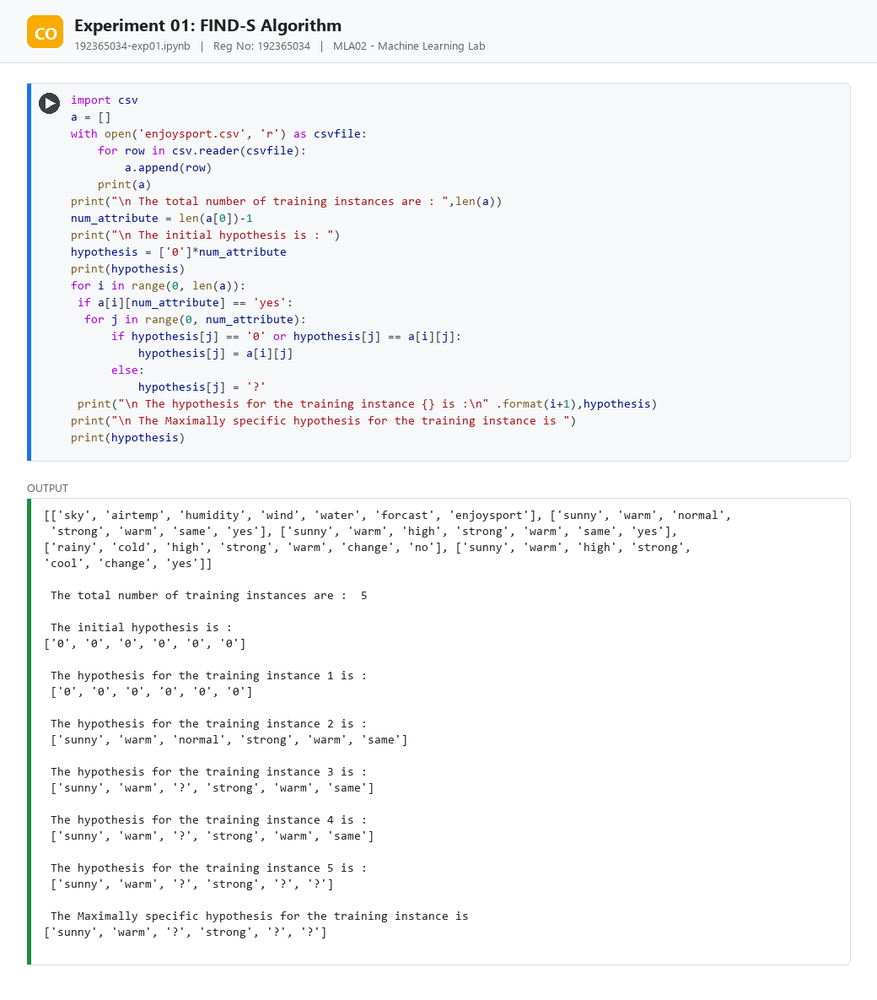

### Experiment 02: Candidate-Elimination Algorithm
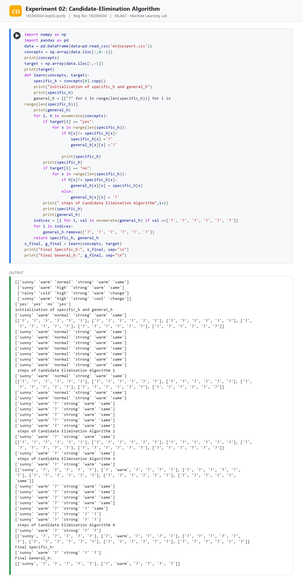

### Experiment 03: ID3 Decision Tree Classifier
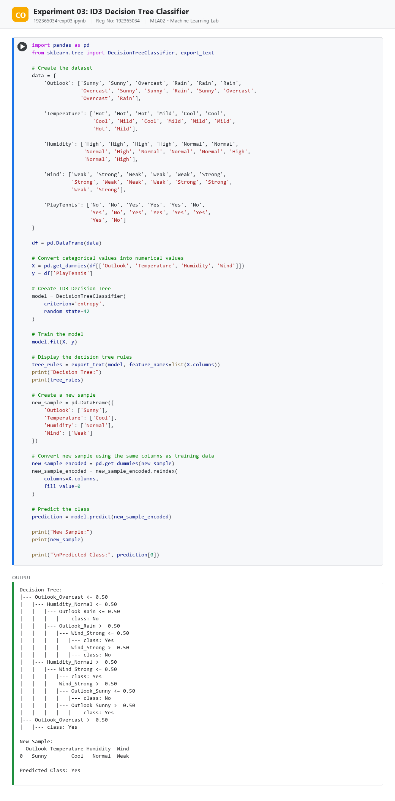

### Experiment 04: Artificial Neural Network (Backpropagation)
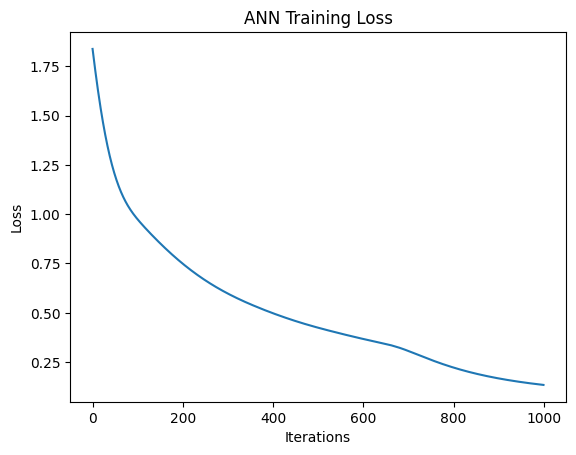

### Experiment 05: K-Nearest Neighbors (KNN) Classifier
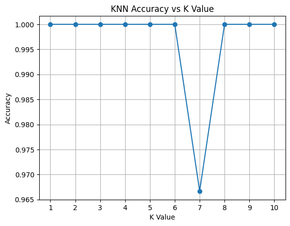

### Experiment 06: Naive Bayes Classifier
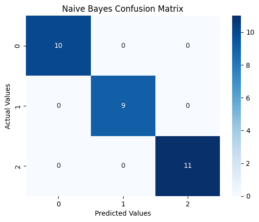

### Experiment 07: Logistic Regression Classifier
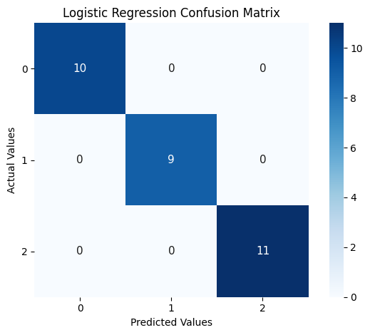

### Experiment 08: Simple Linear Regression
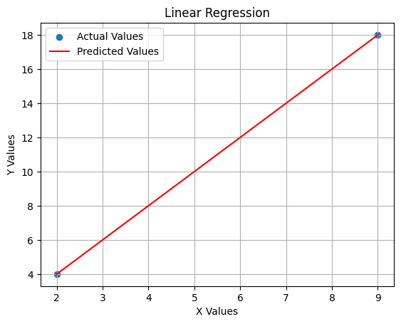

### Experiment 09: Linear vs Polynomial Regression
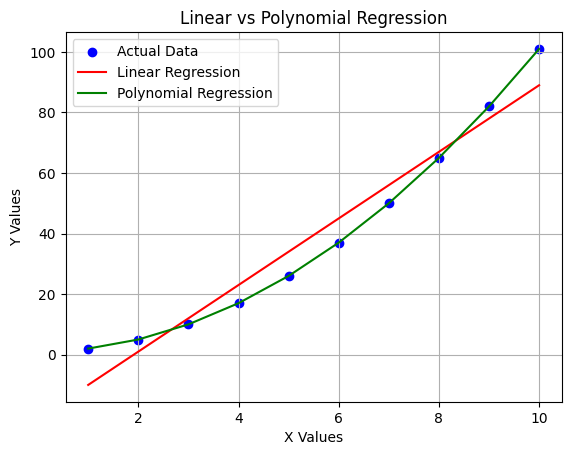

### Experiment 10: Expectation-Maximization (EM) Clustering
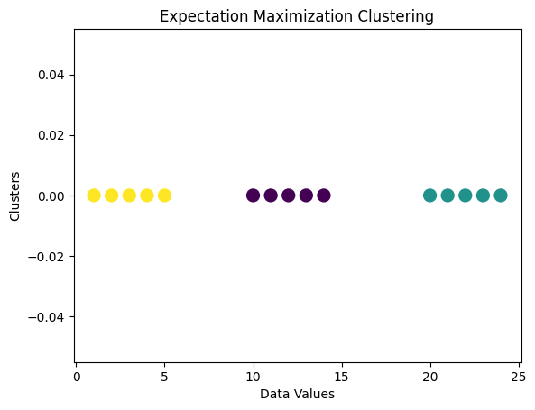

### Experiment 11: Credit Score Classification
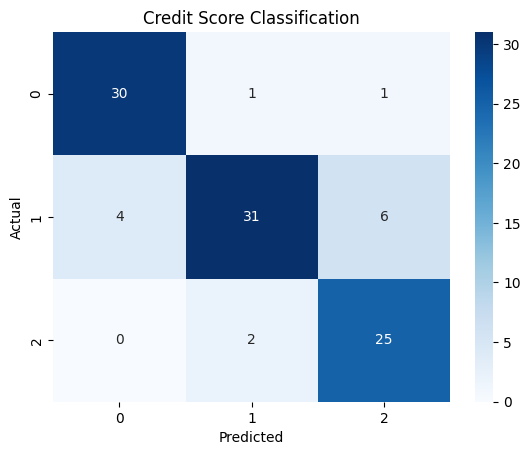

### Experiment 12: Iris Flower Classification using KNN

### Experiment 13: Car Price Prediction
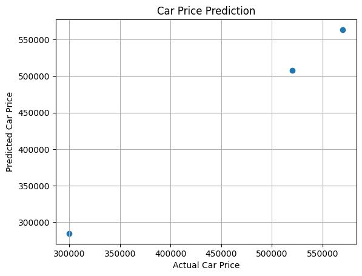

### Experiment 14: House Price Prediction
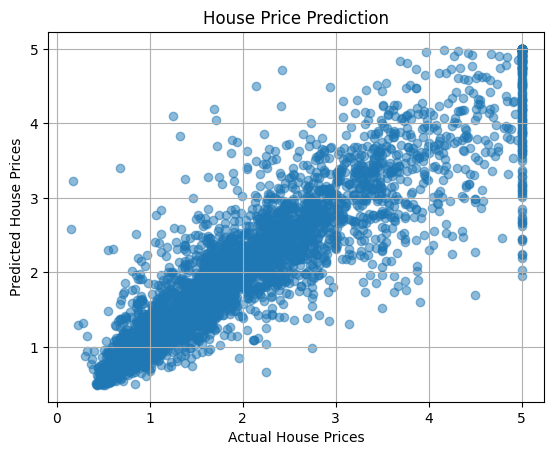

### Experiment 15: Iris Flower Classification using Naive Bayes
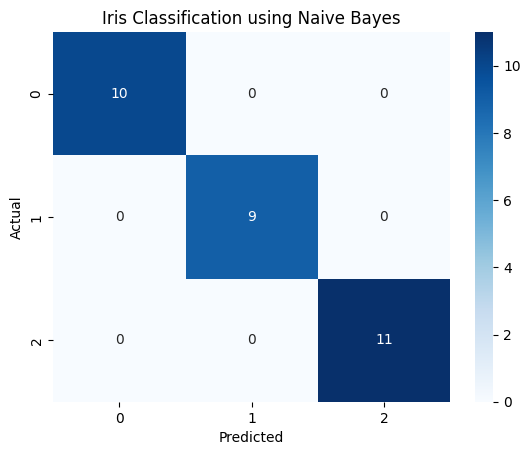

### Experiment 16: Comparison of Classification Algorithms
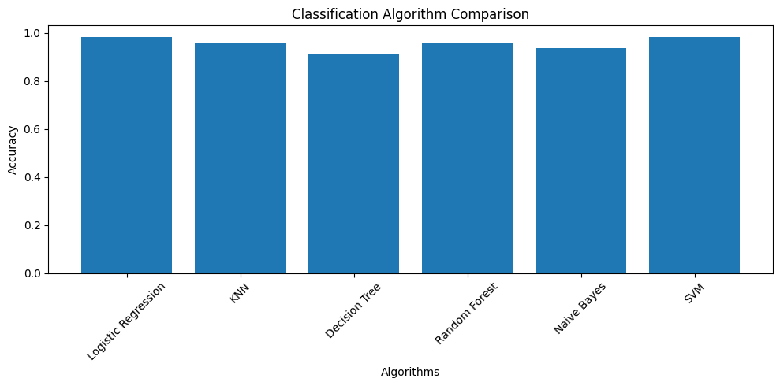
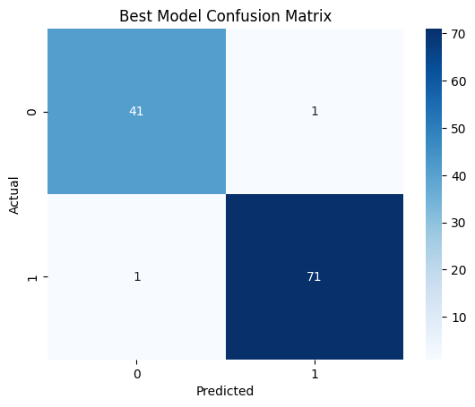
